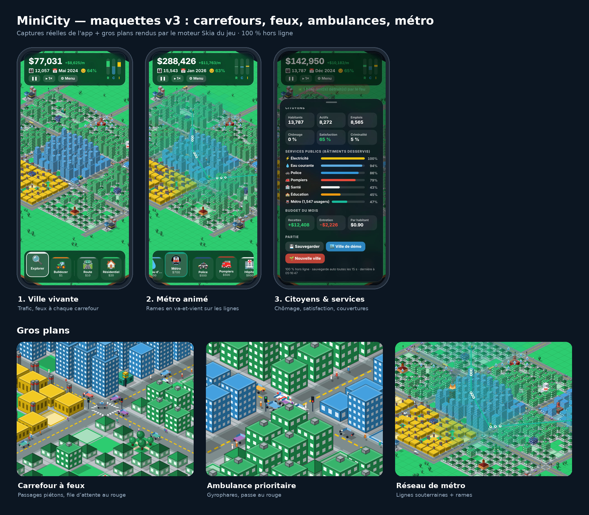
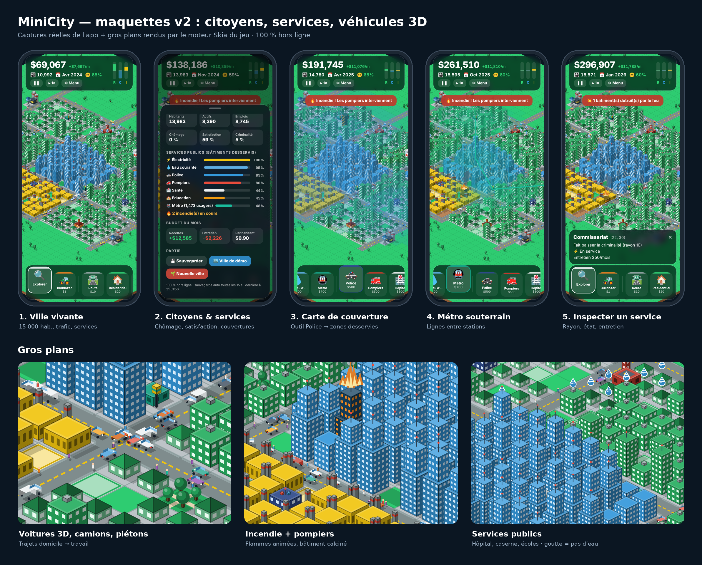
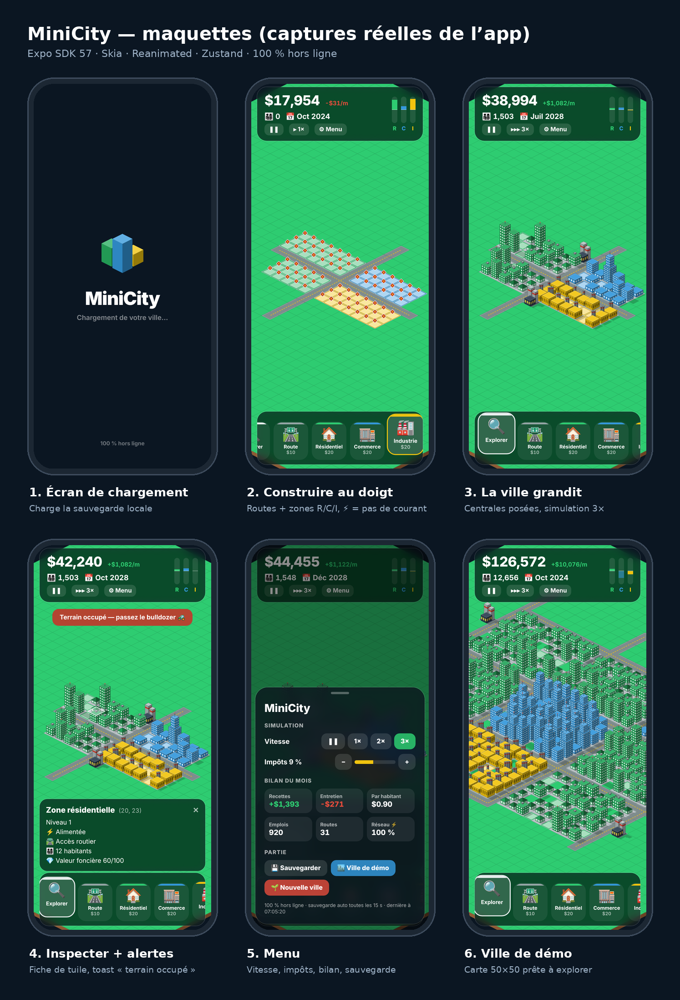

# MiniCity

City-builder isométrique (vibes SimCity 2000) pour mobile, **100 % hors ligne**, jouable dans **Expo Go**.



<details><summary>Maquettes précédentes</summary>



</details>

## Lancer

```bash
npm install
npx expo start        # puis scanner le QR code avec Expo Go
npm run web           # aperçu navigateur (CanvasKit servi en local, aucun CDN)
```

## Jouer

| Geste | Mode Explorer 🔍 | Mode construction |
|---|---|---|
| 1 doigt glissé | déplacer la carte | peindre (routes, zones, bulldozer) |
| 1 toucher | inspecter la tuile | construire |
| 2 doigts | zoomer / déplacer | zoomer / déplacer |

1. Tracer des routes, puis zoner R (vert), C (bleu), I (jaune) à moins de 3 cases d'une route.
2. Poser une centrale : le courant suit routes et zones contiguës jusqu'à 15 cases. ⚡ rouge = pas de courant.
3. Laisser tourner : la demande RCI (jauges du HUD) fait pousser les bâtiments du niveau 1 au niveau 3.
4. Poser un **château d'eau** 💧 (relié au courant) : sans eau, les bâtiments restent au niveau 1.
5. Les **services** élargissent la ville : police 🚓 (criminalité), pompiers 🚒 (incendies), hôpital 🏥,
   école 🏫, parcs 🌳, métro 🚇 (≥ 2 stations : moins de voitures, plus de valeur). Sélectionner l'outil
   d'un service affiche sa **carte de couverture**.
6. Les citoyens vivent : voitures 3D en trajet domicile → travail, camions de livraison, bus, patrouilles
   de police, camions de pompiers vers les incendies, ambulances, piétons. Leur nombre suit la population.
   Chaque carrefour a ses **feux tricolores** et ses passages piétons : les voitures freinent, font la queue
   au rouge et repartent au vert ; pompiers et ambulances passent en priorité. Avec l'outil Métro, on voit
   les lignes souterraines et les rames.
7. Menu ⚙︎ : chômage, satisfaction, criminalité, couverture de chaque service, budget.

## Architecture

```
src/engine/   projection iso 2:1 (iso.ts), rendu Skia (renderer.ts), cache par bandes (mapLayers.ts)
src/sim/      simulation pure : courant + eau (flood fill), services, criminalité, incendies, RCI, budget
src/store/    Zustand (useGameStore) + persistance AsyncStorage
src/hooks/    game loop (1 tick = 1 mois = 2 s) et autoSave (15 s + passage en arrière-plan)
src/ui/       HUD glassmorphism, barre d'outils, fiche, toast, menu, splash
```

- **Rendu** : la carte est enregistrée en `SkPicture` par bandes de 10 lignes (sol, ombres, bâtiments).
  Pan/zoom ne touchent que la matrice caméra (thread UI) ; une modification ne ré-enregistre que les bandes concernées.
- **Raycasting inverse** : `screenToTile` (worklet) annule la caméra puis inverse la projection
  (`gx = dx/W + dy/H`, `gy = dy/H − dx/W`, puis `floor`).
- **Depth sorting** : row-major de (0,0) vers (N−1,N−1).
- **PNJ** (`engine/agents.ts`, `engine/traffic.ts`) : itinéraires calculés côté JS (plus court chemin
  domicile → travail, patrouilles, pompiers, ambulances), puis **micro-simulation du trafic** sur une période
  commune multiple du cycle des feux (suivi de véhicule, freinage, arrêt au rouge). Les trajectoires sont
  enregistrées puis rejouées en boucle dans un worklet, synchronisées avec les feux affichés. Recalcul
  différé (600 ms) pendant la construction. Véhicules 3D = boîtes orientées avec élimination des faces cachées, triées
  par profondeur. Calques superposés (sol, PNJ, bâtiments, incendies) : seuls PNJ et flammes se redessinent
  à chaque image, et seuls les PNJ visibles à l'écran sont dessinés.
