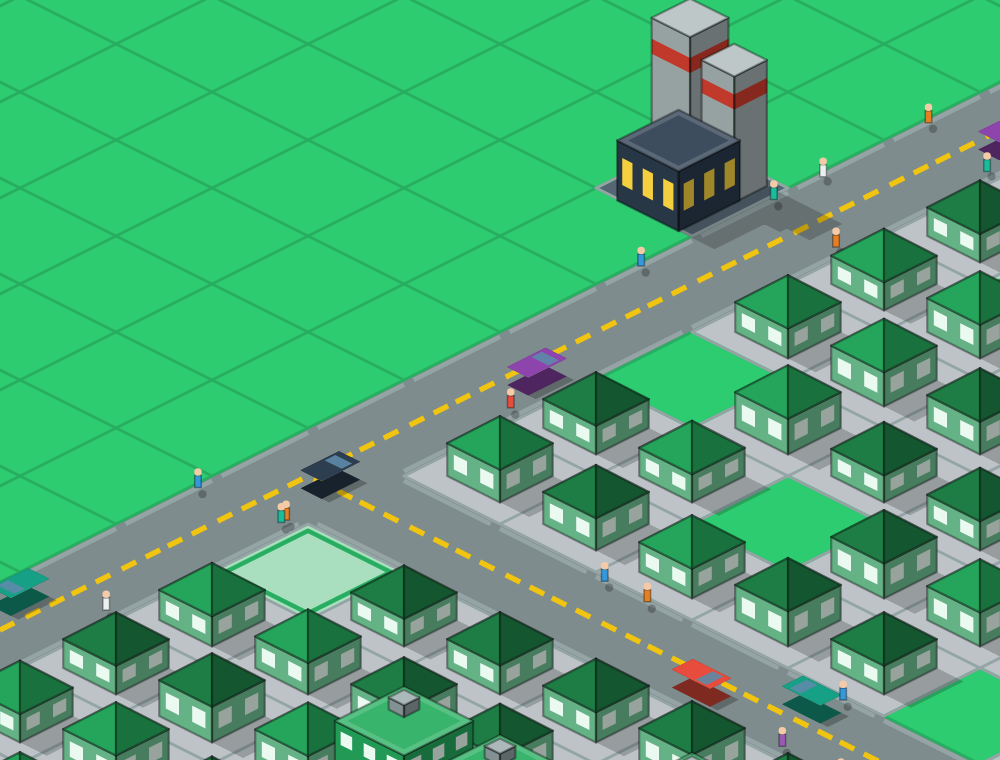

# MiniCity

City-builder isométrique (vibes SimCity 2000) pour mobile, **100 % hors ligne**, jouable dans **Expo Go**.


## Lancer

```bash
npm install
npx expo start        # puis scanner le QR code avec Expo Go
npm run web           # aperçu navigateur (CanvasKit servi en local, aucun CDN)
```

## Jouer

| Geste | Mode Explorer 🔍 | Mode construction |
|---|---|---|
| 1 doigt glissé | déplacer la carte | peindre (routes, zones, bulldozer) |
| 1 toucher | inspecter la tuile | construire |
| 2 doigts | zoomer / déplacer | zoomer / déplacer |

1. Tracer des routes, puis zoner R (vert), C (bleu), I (jaune) à moins de 3 cases d'une route.
2. Poser une centrale : le courant suit routes et zones contiguës jusqu'à 15 cases. ⚡ rouge = pas de courant.
3. Laisser tourner : la demande RCI (jauges du HUD) fait pousser les bâtiments du niveau 1 au niveau 3.
4. Voitures et piétons apparaissent avec les routes et la population (désactivables dans le menu ⚙︎).



## Architecture

```
src/engine/   projection iso 2:1 (iso.ts), rendu Skia (renderer.ts), cache par bandes (mapLayers.ts)
src/sim/      simulation pure : électricité (flood fill), RCI, budget, outils
src/store/    Zustand (useGameStore) + persistance AsyncStorage
src/hooks/    game loop (1 tick = 1 mois = 2 s) et autoSave (15 s + passage en arrière-plan)
src/ui/       HUD glassmorphism, barre d'outils, fiche, toast, menu, splash
```

- **Rendu** : la carte est enregistrée en `SkPicture` par bandes de 10 lignes (sol, ombres, bâtiments).
  Pan/zoom ne touchent que la matrice caméra (thread UI) ; une modification ne ré-enregistre que les bandes concernées.
- **Raycasting inverse** : `screenToTile` (worklet) annule la caméra puis inverse la projection
  (`gx = dx/W + dy/H`, `gy = dy/H − dx/W`, puis `floor`).
- **Depth sorting** : row-major de (0,0) vers (N−1,N−1).
- **PNJ** (`engine/agents.ts`) : itinéraires calculés côté JS quand les routes changent (marche aléatoire
  aller-retour, voie de droite pour les voitures, trottoir pour les piétons), positions interpolées
  chaque image dans un worklet. La carte est rendue en 3 canvas superposés (sol, PNJ, bâtiments) :
  seul le calque PNJ se redessine à chaque image, et seuls les PNJ visibles à l'écran sont dessinés.
