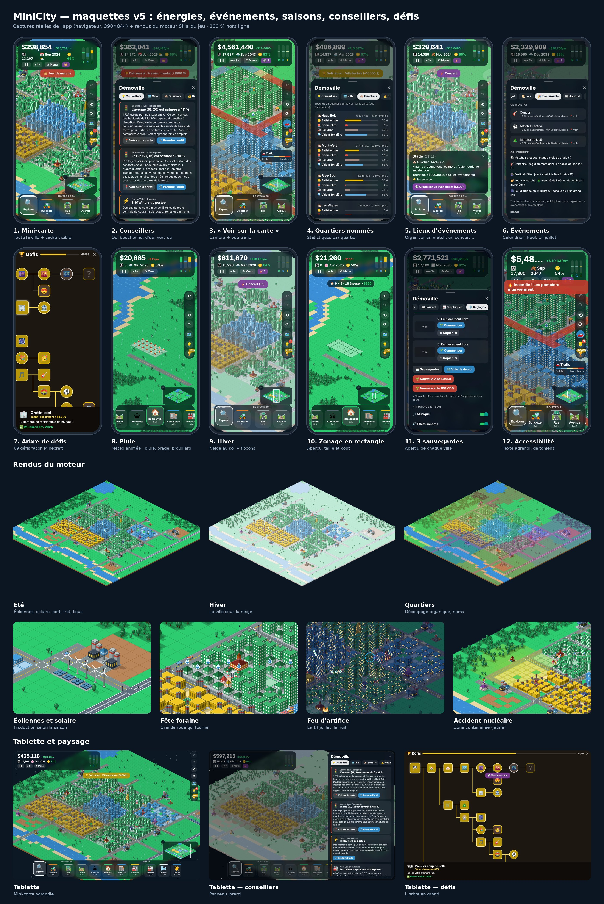
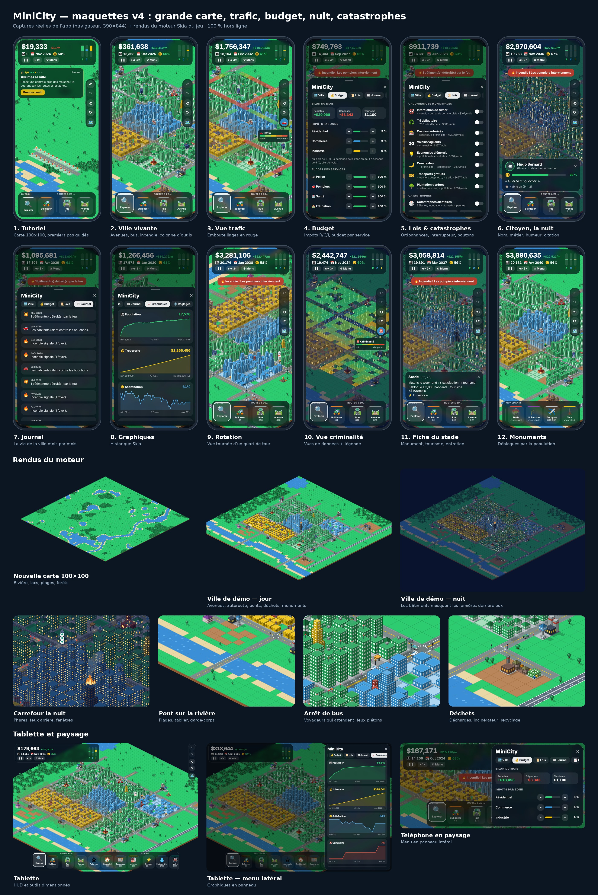

# MiniCity

City-builder isométrique (vibes SimCity 2000) pour mobile, **100 % hors ligne**, jouable dans **Expo Go**.



<details><summary>Maquettes précédentes</summary>




</details>

## Lancer

```bash
npm install
npx expo start        # puis scanner le QR code avec Expo Go
npm run web           # aperçu navigateur (CanvasKit servi en local, aucun CDN)
npm test              # tests automatisés (jest-expo)
```

## Jouer

| Geste | Mode Explorer 🔍 | Mode construction |
|---|---|---|
| 1 doigt glissé | déplacer la carte | peindre (routes, zones, bulldozer) |
| 1 toucher | inspecter la tuile, ou un citoyen | construire |
| 2 doigts | zoomer / déplacer | zoomer / déplacer |

Un **tutoriel** guide les premiers pas (rue → maisons → centrale → eau → emplois). Colonne de droite :
**annuler / rétablir** ↶ ↷, **rotation** de la vue par quarts de tour ⟲ ⟳ et **vues de données** 🗺️
(trafic, pollution, criminalité, valeur foncière, déchets).

1. **Carte 100×100** générée à chaque partie : rivière, lacs, plages, forêts. Les routes passent en **pont**
   au-dessus de l'eau (×4), la forêt est défrichée automatiquement, un château d'eau au bord d'un lac coûte moitié prix.
2. **Routes** : rue, **avenue** (×2,5 de capacité) et **autoroute** (rapide, ne dessert pas les zones).
   Les habitants vont travailler à l'emploi le plus proche en temps de trajet : les **embouteillages** allongent
   les trajets, font baisser la valeur foncière et fâchent les habitants.
3. Zoner R / C / I, poser une centrale ⚡ et un château d'eau 💧 : la demande RCI fait pousser la ville.
4. **Services** (police, pompiers, hôpital, école, parcs, métro, **bus** avec arrêts et voyageurs qui attendent)
   et **déchets** : décharge (se remplit), incinérateur (pollue), recyclage. Sans ramassage, les ordures
   s'entassent et les quartiers se vident.
5. **Pollution** visible (nappes de smog) : industries, centrales, incinérateurs et bouchons.
6. **Budget** (menu ⚙︎) : impôts séparés R / C / I, financement de chaque service de 0 à 120 % (sous 40 % :
   **grève**), **ordonnances** (tri obligatoire, casinos, couvre-feu, transports gratuits…).
7. **Monuments** débloqués par la population : stade (3 000 hab.), université (6 000), aéroport (10 000),
   tour (16 000). Ils rapportent du tourisme.
8. **Catastrophes** (interrupteur dans le menu, ou déclenchées à la main) : séisme (la caméra tremble),
   inondation, tornade (entonnoir animé), panne de centrale.
9. **Jour / nuit** : fenêtres allumées, lampadaires, phares et feux arrière, projecteurs du stade.
10. **Citoyens** : on peut toucher une voiture ou un piéton pour lire sa fiche (nom, âge, métier, humeur, citation).
    Des bulles d'humeur apparaissent au-dessus des passants (bouchons, insécurité, pollution, ordures, impôts, chômage).
11. **Journal de la ville** et **graphiques** d'historique (population, trésorerie, satisfaction, criminalité, pollution).
12. **Sons et musique** synthétisés et embarqués (`scripts/generate-sounds.mjs`), désactivables.
13. **Qualité automatique** : la fluidité est mesurée et la densité de PNJ s'adapte. Tablette et paysage
    gérés (menu en panneau latéral).

### Nouveautés de la v5

14. **Énergies** : charbon (pollue), éoliennes (meilleures l'hiver), solaire (deux fois moins l'hiver), nucléaire
    (débloqué à 4 000 habitants, énorme production… et risque d'accident qui contamine la zone pendant des années).
    Chaque centrale produit des MW ; si la production ne suffit pas, les quartiers les plus éloignés sont délestés.
15. **Port et gare de fret** : au-delà de 1 500 habitants, les usines doivent exporter. Le port se construit au bord
    de l'eau ; les camions vont des usines au port.
16. **Lieux et événements** : marché, fête foraine (grande roue qui tourne), salle de concert, stade. Matchs, concerts,
    festival d'été, marché de Noël en décembre, feu d'artifice du 14 juillet ; foules de spectateurs ; on peut
    organiser un événement depuis la fiche d'un lieu.
17. **Saisons et météo** : neige l'hiver (chasse-neige si le budget transports est ≥ 80 %, sinon la ville est
    paralysée), automne roux, canicule (incendies), pluie, orage avec éclairs, brouillard, ombres de nuages.
18. **Quartiers nommés** (Belle-Rive, Les Forges…) avec satisfaction, criminalité, pollution et valeur par quartier.
19. **Conseillers** : ils expliquent les problèmes et leurs causes (« L'avenue (18, 20) est saturée : ce sont surtout
    des habitants de Mont-Vert qui vont travailler à Haut-Bois ») et emmènent la caméra sur place.
20. **Arbre de défis** façon Minecraft : 69 défis en 8 branches (croissance, énergie, services, transports,
    économie, environnement, culture, mandat), avec récompenses.
21. **Reconstruction** : un bâtiment détruit garde son zonage et se reconstruit en priorité.
22. **Mini-carte**, **zonage en rectangle** et **routes droites** (aperçu et coût pendant le glisser),
    **3 emplacements de sauvegarde** avec aperçu, **accessibilité** (taille du texte, palette daltonienne, vibrations).

### Nouveautés de la v6

23. **Relief** : collines et montagnes (4 niveaux), falaises, outils « Monter » / « Creuser » (terrassement en
    terrasses), routes en rampe, **tunnels** sous les montagnes, **ponts suspendus** (pylônes et câbles) au-delà de
    4 tuiles. Les hauteurs ont une meilleure vue (+ valeur) et restent au sec pendant les inondations.
24. **Tramway** sur les avenues (rames animées, caténaires) et **trains de voyageurs** : voies ferrées, gares
    (au moins deux reliées), passages à niveau avec barrières.
25. **Avions** qui décollent de l'aéroport, **voiliers** sur les lacs, **cargos** au départ du port.
26. **Parkings** : indispensables aux tours de bureaux au-delà de 2 500 habitants.
27. **Niveau d'éducation** : école 40 %, lycée 35 %, université 25 % ; sans diplômés, pas de bureaux ni de
    haute technologie.
28. **Industries spécialisées** : fermes à la campagne, scieries près des forêts, campus de haute technologie
    quand la population est instruite (moins polluants, visuels propres).
29. **Tourisme** : plages aménagées, hôtels (sans chambre, les touristes dépensent moitié moins), touristes visibles
    en chemise à fleurs.
30. **Station d'épuration** et **pollution de l'eau** (lacs troubles, plages désertées), **épidémies** par quartier
    (voile violet, vue « Santé »), **feux de forêt** qui se propagent d'arbre en arbre.
31. **Catastrophes fun** (à activer) : **météorite** (cratère, incendies) et **monstre géant** qui traverse la ville.
32. **Saisons vivantes** : arbres verts, roux, nus, cerisiers en fleurs et fleurs dans l'herbe au printemps, grands
    sapins décorés dans les parcs en décembre. **Architecture par quartier** (moderne, classique, brique, colorée).
33. **Ambiance sonore** : rumeur de la ville, oiseaux, pluie, vent, foule des événements, grillons la nuit.
34. **Demandes des habitants** : un quartier réclame un parc, une école, moins de pollution… avec une échéance
    et une récompense. **Records** (population, caisse, meilleur mois, pire catastrophe…) et **timelapse** de
    la ville (une image tous les 6 mois).
35. **Nouveau logo** (île isométrique de nuit) et icônes Android adaptatives.

### Qualité

- **91 tests jest** dont des tests aléatoires et un **monkey test du store** (milliers d'actions au hasard :
  outils, glissers, annuler / rétablir, mois qui passent, rotation, sauvegarde / rechargement…). Les invariants
  de la carte et des statistiques sont vérifiés après chaque action. Campagnes longues :
  `MONKEY_SEEDS=20 MONKEY_STEPS=5000 npx jest monkey`.
- Un test garde-fou vérifie l'ordre de déclaration des fonctions `'worklet'` (sinon plantage au chargement).

## Architecture

```
src/engine/   projection iso 2:1 (iso.ts), rendu Skia (renderer.ts), blocs + culling (mapLayers.ts),
              terrain (terrain.ts), rotation (rotation.ts), PNJ (agents.ts), feux (traffic.ts)
src/sim/      simulation pure : courant + eau, trafic (Dijkstra), pollution, déchets, services,
              criminalité, incendies, catastrophes, RCI, budget, ordonnances, éducation, tourisme,
              eau, épidémies, missions (missions.ts), records (records.ts)
src/store/    Zustand (useGameStore, annuler/rétablir) + persistance AsyncStorage (sauvegarde v3 validée, réglages)
src/hooks/    game loop (1 tick = 1 mois = 2 s), autoSave (15 s + arrière-plan), qualité automatique
src/audio/    sons et musique hors ligne (expo-audio)
src/ui/       HUD, barre d'outils, commandes de carte, menu à onglets, graphiques, tutoriel, fiches
src/__tests__ tests jest (moteur, simulation, outils, sauvegarde, PNJ, énergie, événements, conseillers, défis…)
```

- **Rendu** : la carte est enregistrée en `SkPicture` par blocs de 10×10 tuiles (sol, ombres, bâtiments, lumières).
  Pan/zoom ne touchent que la matrice caméra (thread UI) et seuls les blocs visibles sont rejoués (culling) ;
  une modification ne ré-enregistre que les blocs concernés. La rotation réutilise les tuiles non modifiées.
- **Raycasting inverse** : `screenToTile` (worklet) annule la caméra puis inverse la projection
  (`gx = dx/W + dy/H`, `gy = dy/H − dx/W`, puis `floor`).
- **Depth sorting** : row-major de (0,0) vers (N−1,N−1).
- **PNJ** (`engine/agents.ts`, `engine/traffic.ts`) : itinéraires calculés côté JS (plus court chemin
  domicile → travail, patrouilles, pompiers, ambulances), puis **micro-simulation du trafic** sur une période
  commune multiple du cycle des feux (suivi de véhicule, freinage, arrêt au rouge, priorité dans le carrefour,
  feux piétons, arrêts de bus, voies multiples sur avenues et autoroutes). Les trajectoires sont
  enregistrées puis rejouées en boucle dans un worklet, synchronisées avec les feux affichés. Recalcul
  différé (600 ms) pendant la construction, découpé en tranches de 6 ms pour ne jamais bloquer les gestes. Véhicules 3D = boîtes orientées avec élimination des faces cachées, triées
  par profondeur. Calques superposés (sol, PNJ, bâtiments, incendies) : seuls PNJ et flammes se redessinent
  à chaque image, et seuls les PNJ visibles à l'écran sont dessinés.
